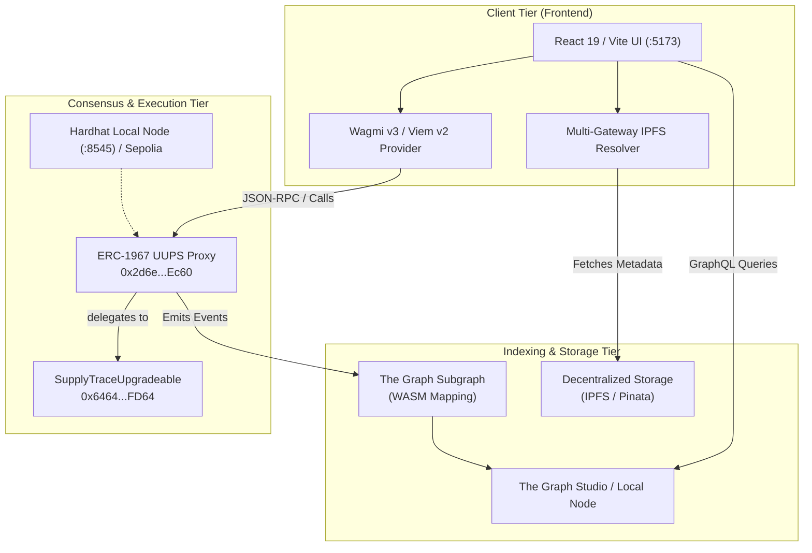

# SupplyTrace

<p align="center">
  
  
  
  
  
  
  
</p>

> **Decentralized supply chain provenance and verification on Ethereum.**  
> Tokenize physical product batches as ERC-1155 tokens, enforce cryptographically verified custody transfers on-chain, and allow any consumer to verify product origin and authenticity instantly — zero intermediaries required.

---

## 1. Overview & Problem Statement

Global supply chains suffer from widespread vulnerabilities: counterfeit goods, opaque custody transfers, paper-based tracking prone to fraud, and slow, imprecise recall mechanisms.

**SupplyTrace** resolves these challenges by providing an immutable, public audit trail on the Ethereum blockchain:
- **Manufacturers** mint batches with immutable IPFS-linked metadata (origin, batch numbers, certifications).
- **Supply Chain Custody** follows a strictly enforced state machine (`Manufacturer` → `Distributor` → `Retailer` → `Sold`).
- **Consumers** verify authenticity by scanning a product QR code without needing a Web3 wallet or browser extension.
- **Auditors & Admins** can freeze compromised batches via emergency recall and circuit-breaker pause mechanisms.

---

## 2. Architecture Overview

SupplyTrace is structured into three distinct tiers:



---

## 3. Verified Features

| Feature | Implementation Status | Technical Detail |
| :--- | :---: | :--- |
| **ERC-1155 Batch Minting** | Verified | Role-restricted to `MANUFACTURER_ROLE`. Mints unique `tokenId` with batch quantity and IPFS URI. |
| **Strict Custody State Machine** | Verified | State transitions strictly enforced: `CREATED` → `DISTRIBUTED` → `RETAIL` → `SOLD`. State rollback or reuse is blocked. |
| **Role-Gated Access Control** | Verified | OpenZeppelin `AccessControlUpgradeable` with `ADMIN_ROLE`, `MANUFACTURER_ROLE`, `DISTRIBUTOR_ROLE`, `RETAILER_ROLE`. |
| **Emergency Batch Recall** | Verified | Admins can recall active batches into `CLOSED` state; operates even when contract is paused. |
| **Pausable Circuit Breaker** | Verified | Pauses minting and token transfers while preserving emergency recall capabilities. Admin UI integration verified. |
| **UUPS Upgradeability** | Verified | ERC-1967 proxy with 45 reserved storage gap slots (`__gap[45]`) and upgrade authorization restricted to `ADMIN_ROLE`. |
| **Consumer QR Verification** | Verified | Public route (`/verify/:tokenId`) resolves batch metadata, manufacturer address, and custody count without requiring a wallet. |
| **Multi-Gateway IPFS Fetcher** | Verified | Failover across 4 public gateways (`ipfs.io`, `dweb.link`, `gateway.pinata.cloud`, `cloudflare-ipfs.com`). |
| **The Graph Indexing** | Verified | Subgraph indexes `BatchMinted`, `BatchTransferred`, `BatchRecalled` into GraphQL entities with RPC log fallback. |
| **Multi-Sig Governance Handoff**| Verified | Automated script to transfer `ADMIN_ROLE` and `DEFAULT_ADMIN_ROLE` to a Gnosis Safe multi-sig contract. |

---

## 4. Technology Stack

### Smart Contracts (Execution Tier)
- **Language**: Solidity `0.8.22` (EVM target: `paris`)
- **Framework**: Hardhat `2.22.3`
- **Libraries**: OpenZeppelin Contracts Upgradeable `v5.4.0` (ERC-1155, UUPSUpgradeable, AccessControlUpgradeable, PausableUpgradeable, ReentrancyGuardUpgradeable)
- **Deployment & Typings**: `hardhat-deploy`, `@openzeppelin/hardhat-upgrades`, TypeChain (Ethers v6)
- **Test Framework**: Mocha, Chai (63 unit tests passing)

### Frontend (Client Tier)
- **Framework**: React `19.2.0`, Vite `7.3.1`
- **Language**: TypeScript `~5.9.3` (Strict Mode)
- **Styling**: Tailwind CSS `3.4.10`, Radix UI primitives, Lucide Icons, Framer Motion
- **Web3 Integration**: Wagmi `3.5.0`, Viem `2.46.3`, `@tanstack/react-query` `5.90.21`
- **QR Generation & Scanning**: `qrcode`, `html5-qrcode`

### Subgraph (Indexing Tier)
- **Runtime**: The Graph Protocol (Spec: `0.0.4`, Mapping API: `0.0.6`)
- **Compiler**: `@graphprotocol/graph-cli` `0.98.1`, `@graphprotocol/graph-ts` `0.35.1`

### Database & Realtime (Off-Chain Coordination Tier)
- **Platform**: Supabase (PostgreSQL 17 + Realtime WebSockets)
- **Client**: `@supabase/supabase-js` `^2.99.1`
- **Tables**: `supplytrace_role_applications` (enterprise onboarding queue), `supplytrace_organizations` (verified profiles)
- **Security**: Row Level Security (RLS) enabled on all tables

---

## 5. Repository Directory Tree

```
SupplyTrace/
├── Start.bat                         # Interactive & CLI Windows launcher
├── init.md                           # Comprehensive environment & bootstrap contract
├── PROJECT_AUDIT.md                  # Complete architectural audit & execution log
├── SECURITY.md                       # Threat model, invariants, and security disclosure
├── README.md                         # Project documentation
├── .env.example                      # Root environment variable template
├── .npmrc                            # Root npm config (legacy-peer-deps=true)
├── package.json                      # Root workspace scripts (--prefix delegation)
├── package-lock.json                 # Root lockfile
│
├── smart-contracts/                  # Consensus & Smart Contracts Tier
│   ├── contracts/
│   │   ├── SupplyTraceUpgradeable.sol    # Canonical UUPS proxy implementation
│   │   ├── SupplyTraceUpgradeableV2.sol  # V2 upgrade demonstration contract
│   │   └── legacy/
│   │       └── SupplyTrace.sol           # Non-upgradeable prototype (archived)
│   ├── deploy/
│   │   └── 00_deploy_supplytrace.ts      # Automated deterministic deployment script
│   ├── scripts/
│   │   ├── deploy.ts                     # Manual UUPS proxy deployer
│   │   ├── upgrade.ts                    # UUPS proxy upgrade helper
│   │   ├── export-frontend.ts            # Copies ABI & address to frontend
│   │   ├── grant-roles.ts                # Assigns supply chain roles to an address
│   │   ├── check-roles.ts                # Queries active roles for an address
│   │   └── transfer-admin-to-safe.ts     # Transfers admin roles to Gnosis Safe
│   ├── test/
│   │   └── SupplyTrace.test.ts           # 63 unit tests across 8 test suites
│   ├── .openzeppelin/
│   │   └── sepolia.json                  # Linear storage layout registry (slots 0-4)
│   ├── hardhat.config.ts                 # Hardhat configuration (Solidity, networks, accounts)
│   ├── .env.example                      # Contract environment template
│   └── package.json                      # Contract dependencies and scripts
│
├── frontend/                         # React 19 Client Web Application
│   ├── src/
│   │   ├── config/
│   │   │   └── contracts.ts              # Canonical contract address & ABI export
│   │   ├── contracts/
│   │   │   └── SupplyTrace.json          # Exported ABI synced from smart contracts
│   │   ├── pages/
│   │   │   ├── Dashboard.tsx             # Overview and role-gated quick actions
│   │   │   ├── MintBatch.tsx             # Batch tokenization form & QR generator
│   │   │   ├── TransferBatch.tsx         # Custody transfer with recipient routing
│   │   │   ├── ExploreBatches.tsx        # Searchable table of all on-chain batches
│   │   │   ├── Verify.tsx                # Public consumer verification portal
│   │   │   ├── AdminPanel.tsx            # Circuit breaker, recall, role management
│   │   │   └── Settings.tsx              # Theme switcher & wallet status
│   │   ├── hooks/
│   │   │   ├── useBatches.ts             # On-chain batch discovery via event logs
│   │   │   ├── useRole.ts                # Resolves caller's supply chain roles
│   │   │   └── useSubgraphCustody.ts     # Custody transfer history via GraphQL
│   │   ├── lib/
│   │   │   ├── ipfs-gateways.ts          # Resilient multi-gateway IPFS fetcher
│   │   │   └── theme.tsx                 # Light / Dark theme context provider
│   │   └── main.tsx                      # Wagmi & QueryClient provider configuration
│   ├── .env.example                      # Frontend environment template
│   ├── eslint.config.js                  # ESLint 9 configuration
│   ├── vercel.json                       # Vercel SPA client-side routing configuration
│   └── package.json                      # Frontend dependencies and build scripts
│
└── subgraph/                         # The Graph Indexing Subsystem
    ├── schema.graphql                    # GraphQL schema (Batch, CustodyTransfer, Recall)
    ├── subgraph.yaml                     # Manifest declaring event handlers & ABIs
    ├── src/
    │   └── mapping.ts                    # AssemblyScript event handlers
    ├── abis/
    │   └── SupplyTraceUpgradeable.json   # Contract ABI for graph codegen
    └── package.json                      # Graph CLI dependencies & codegen scripts
```

---

## 6. Prerequisites & Supported Runtimes

| Requirement | Supported Version | Host Verified Version | Notes |
| :--- | :--- | :--- | :--- |
| **Node.js** | `>= 20.0.0` (LTS) | `v24.16.0` | Active LTS or current v24 |
| **npm** | `>= 10.0.0` | `12.0.2` | Workspaces supported via `--prefix` |
| **Git** | `>= 2.40.0` | `2.56.0.windows.2`| Required for submodules / tracking |
| **Browser** | Chromium / Firefox | Brave, Chrome, Edge | Web3 wallet extension required for writes |

---

## 7. First-Time Installation & Setup

### Clone Repository
```bash
git clone https://github.com/JaiivantArvind/SupplyTrace.git
cd SupplyTrace
```

### Install Dependencies
Dependencies are installed per tier using npm's declared package manifests and lockfiles:
```bash
# Option A: Run via the Windows launcher (recommended)
Start.bat install

# Option B: Run manually via CLI
npm ci --prefix smart-contracts
npm ci --prefix frontend
npm install --prefix subgraph
```

---

## 8. Environment Variables & Configuration

Copy the example environment files into local active configurations:

```cmd
copy .env.example .env
copy smart-contracts\.env.example smart-contracts\.env
copy frontend\.env.example frontend\.env
```

### Configuration Key Reference

| Variable | Tier | Purpose | Default / Example Value |
| :--- | :--- | :--- | :--- |
| `SEPOLIA_RPC_URL` | Smart Contracts | Ethereum Sepolia JSON-RPC URL | `https://sepolia.infura.io/v3/YOUR_KEY` |
| `PRIVATE_KEY` | Smart Contracts | 32-byte hex deployer private key | Masked / Placeholder |
| `ETHERSCAN_API_KEY` | Smart Contracts | Contract source verification key | Optional placeholder |
| `VITE_CONTRACT_ADDRESS`| Frontend | Target SupplyTrace proxy address | `0x2d6e1979c944DdfCBF34FE1f172DED5e600bEc60` |
| `VITE_SUBGRAPH_URL` | Frontend | The Graph GraphQL query URL | Optional (falls back to RPC logs) |
| `PINATA_JWT` | Frontend | IPFS pinning service token | Optional (demo fallback active) |
| `VITE_SUPABASE_URL` | Frontend | Supabase Project URL | `https://your-project.supabase.co` |
| `VITE_SUPABASE_ANON_KEY`| Frontend | Supabase public Anon API key | Supabase public JWT token |

> 🔒 **Security Notice**: Never commit `.env` files or private keys. The root `.gitignore` excludes all `.env` files across all directories.

---

## 9. Running Through `Start.bat`

The root [Start.bat](file:///d:/Work/My%20Projects/SupplyTrace/T-1/SupplyTrace/Start.bat) file provides automated environment initialization, prerequisite checking, port conflict avoidance, and multi-tier process management.

### Interactive Menu Mode
Simply double-click `Start.bat` or run:
```cmd
Start.bat
```
Menu options:
- `[1] Full Local Stack (Node + Deploy + Web UI)` — Launches a local Hardhat node on port 8545, polls until ready, deploys contracts, seeds local test roles, exports ABI to frontend, and opens `http://localhost:5173`.
- `[2] Start Frontend Only` — Launches the Vite frontend connected to Sepolia or configured network.
- `[3] Start Local Hardhat Node Only` — Starts the local node on port 8545 in a dedicated window.
- `[4] Deploy Contracts to Localhost` — Deploys contracts to an active localhost node and exports artifacts.
- `[5] Run Smart Contract Unit Tests` — Runs the full 63-test Mocha test suite.
- `[6] Build Production Monorepo` — Compiles smart contracts and produces the optimized Vite production bundle.
- `[7] Run Strict Typecheck and Linting` — Executes `tsc -b` and ESLint.
- `[8] Verify / Reinstall All Dependencies` — Verifies or cleanly reinstalls packages.
- `[0] Exit` — Terminates launcher.

### Scriptable CLI Mode
For CI/CD or non-interactive execution:
```cmd
Start.bat full       # Full local stack orchestration
Start.bat frontend   # Launch Vite frontend server only
Start.bat test       # Run 63 smart contract unit tests
Start.bat build      # Compile contracts and build Vite production bundle
Start.bat lint       # Run TypeScript strict typecheck & ESLint
Start.bat check      # Validate prerequisites and environment templates
```

---

## 10. Manual Development Commands

If developing from the command line without the batch launcher:

```bash
# 1. Compile smart contracts
npm run compile --prefix smart-contracts

# 2. Run smart contract test suite
npm test

# 3. Start local Hardhat node
npx hardhat node --prefix smart-contracts

# 4. Deploy to local node & export ABI (in a separate terminal)
npx hardhat deploy --network localhost --reset --prefix smart-contracts
npx hardhat run scripts/export-frontend.ts --network localhost --prefix smart-contracts

# 5. Start frontend dev server
npm run dev

# 6. Typecheck and lint frontend
npx tsc -b --prefix frontend
npm run lint

# 7. Compile subgraph WASM mapping
npm run codegen --prefix subgraph
npm run build --prefix subgraph
```

---

## 11. Application URLs & Network Endpoints

| Service | Address / Port | Network / Context | Notes |
| :--- | :--- | :--- | :--- |
| **Production Web App** | `https://supplytrace-mauve.vercel.app` | Global / Web | Live deployed on Vercel (SPA rewrites enabled) |
| **Frontend Web App** | `http://localhost:5173` | Browser | Vite development server |
| **Local Hardhat RPC** | `http://127.0.0.1:8545` | Chain ID `31337` | Local development chain |
| **Sepolia Testnet RPC**| `https://rpc.sepolia.org` | Chain ID `11155111` | Ethereum Sepolia testnet |
| **Sepolia Proxy** | `0x2d6e1979c944DdfCBF34FE1f172DED5e600bEc60` | Sepolia | Live deployed UUPS proxy |
| **Sepolia Implementation**| `0x64641Ed583aB4aC7AAAa84213522f130F5e4FD64` | Sepolia | Underlying logic contract |
| **IPFS Public Gateway**| `https://ipfs.io/ipfs/<CID>` | Global | Fallback gateway |
| **Pinata Gateway** | `https://gateway.pinata.cloud/ipfs/<CID>`| Global | Primary IPFS gateway |

---

## 12. Primary Application Workflows

### Workflow 1: Batch Tokenization (Manufacturer)
1. Navigate to `/mint` and connect a wallet holding `MANUFACTURER_ROLE`.
2. Enter batch metadata (Product Name, SKU, Certification, Quantity, IPFS URI).
3. Confirm the `mintBatch(metadataURI, quantity)` transaction in MetaMask.
4. On transaction confirmation, the application decodes the `BatchMinted` event, reveals the assigned `tokenId`, and renders a printable QR code linking to `/verify/:tokenId`.

### Workflow 2: Custody Transfer (Supply Chain Actor)
1. Navigate to `/transfer` and connect a wallet holding the current custody role.
2. Enter `tokenId`, recipient address, and transfer quantity.
3. The contract enforces role transition validation:
   - Manufacturer can only transfer to a verified `DISTRIBUTOR_ROLE` (`CREATED` → `DISTRIBUTED`).
   - Distributor can only transfer to a verified `RETAILER_ROLE` (`DISTRIBUTED` → `RETAIL`).
   - Retailer marks the batch `SOLD` upon sale to the final consumer.
4. `BatchTransferred` is emitted with an immutable timestamp and indexed by The Graph.

### Workflow 3: Consumer Verification (Public / Walletless)
1. Consumer scans the physical product QR code or navigates directly to `/verify/:tokenId`.
2. No wallet connection or gas tokens are required.
3. The client queries `verifyAuthenticity(tokenId)` directly from the blockchain:
   - Manufacturer address
   - Active status (Authentic vs Recalled)
   - Current lifecycle state badge
   - Total custody handoffs
4. IPFS metadata is resolved in parallel with automatic gateway fallback to display product photos, origin coordinates, and inspection certificates.

### Workflow 4: Emergency Recall & Circuit Breaker (Admin)
1. If a safety defect or counterfeit batch is detected, an admin accesses `/admin`.
2. Enter the affected `tokenId` and execute `recallBatch(tokenId)`.
3. The batch is permanently set to `active = false` and transitioned to `CLOSED`. Any subsequent attempts to transfer or trade this token revert immediately with `BatchInactive()`.
4. If a widespread security issue occurs, the admin can toggle the contract-wide Circuit Breaker (`pause()`), halting all token transfers while preserving emergency recall operations.

---

## 13. Data Models & Storage Layout

### Smart Contract Storage Layout (`SupplyTraceUpgradeable.sol`)
The contract inherits OpenZeppelin Upgradeable contracts using ERC-7201 namespaced storage. The custom state variables occupy linear slots 0 through 4:

| Slot Index | Variable Name | Type | Notes |
| :---: | :--- | :--- | :--- |
| **0** | `batches` | `mapping(uint256 => ProductBatch)` | Batch metadata & quantity struct |
| **1** | `_legacyCustodyHistory` | `mapping(uint256 => CustodyRecord[])` | Archived / layout-frozen |
| **2** | `batchState` | `mapping(uint256 => BatchState)` | Enum (0: CREATED, 1: DISTRIBUTED, 2: RETAIL, 3: SOLD, 4: CLOSED) |
| **3** | `_nextTokenId` | `uint256` | Monotonically incrementing token identifier |
| **4** | `_custodyCount` | `mapping(uint256 => uint256)` | Handoff counter for quick verification |
| **5–49**| `__gap` | `uint256[45]` | Reserved storage slots for future V2/V3 upgrades |

### IPFS Metadata Schema
Batches store JSON documents on IPFS referencing the product identity:
```json
{
  "name": "Organic Arabica Coffee Batch #409",
  "description": "Fair-trade certified single-origin coffee beans",
  "manufacturer": "Andes Coffee Collective",
  "manufactureDate": "2026-03-15",
  "location": "4.5709,-74.2973",
  "certifications": [
    { "name": "Fair Trade Certified", "hash": "0x4a9b...7f21" },
    { "name": "USDA Organic", "hash": "0x1b8c...90e3" }
  ],
  "image": "ipfs://QmXoypizjW3WknFiJnKLwHCnL72vedxjQkDDP1mXWo6uco"
}
```

---

## 14. Testing & Validation

The test suite covers full contract lifecycle, role enforcement, security invariants, reentrancy guards, and upgrade mechanics:

```bash
npm test
```

### Verified Test Suite Breakdown (63 Passing Tests)
- **Deployment Suite**: Validates `ADMIN_ROLE` and `DEFAULT_ADMIN_ROLE` assignment to deployer.
- **Role Assignment Suite**: Verifies admin role granting and ensures non-admins revert with custom errors.
- **Minting Suite**: Validates manufacturer authorization, zero quantity rejection, empty URI rejection, and `_nextTokenId` incrementation.
- **Transfer Hierarchy Suite**: Verifies sequential custody transitions, role matching, stranger transfer reverts, and custody count tracking.
- **Recall Suite**: Tests emergency recall, deactivation, double-recall prevention, and recall under pause.
- **verifyAuthenticity Suite**: Validates manufacturer lookup, active flag check, metadata URI retrieval, and non-existent token reverts.
- **Pausable Suite**: Validates circuit breaker activation, minting/transfer blockage while paused, and recall exemption.
- **UUPS Upgrade Suite**: Simulates V2 upgrade, ensures state persistence across proxy implementations, and blocks unauthorized upgrades.
- **Multi-Sig Governance Suite**: Simulates Gnosis Safe takeover, role revocation, and upgrade execution under multi-sig ownership.
- **Audit Invariants Suite**: Verifies sequential state transitions, reentrancy resistance, and event argument schemas.

---

## 15. Troubleshooting & FAQ

### 1. `Error HH8: Invalid account #0 for network sepolia - private key too short`
- **Cause**: Hardhat was passed an unconfigured placeholder string (e.g. `your_deployer_private_key_here`) as `PRIVATE_KEY`.
- **Solution**: The configuration in `smart-contracts/hardhat.config.ts` includes `isValidPrivateKey` regex validation. Ensure `smart-contracts/.env` either contains a valid 64-character hex private key or leave it empty when testing on local nodes.

### 2. `netstat` detects port 8545 or 5173 already in use
- **Cause**: A background Hardhat node or Vite process from a previous session is still listening.
- **Solution**: Run `Start.bat` Option `[1]`; it will detect the running instance and reuse it without conflict. Alternatively, close the existing node window or terminate the process in Task Manager.

### 3. Frontend Displays "GraphQL query failed" or empty history
- **Cause**: The Graph Subgraph URL in `VITE_SUBGRAPH_URL` is unset or points to an unindexed deployment.
- **Solution**: This is normal for local development. The frontend automatically falls back to querying on-chain event logs (`publicClient.getLogs`) via `useBatches.ts`.

---

## 16. Security Considerations & Invariants

1. **Checks-Effects-Interactions Pattern**:
   `batchState[tokenId]` and `_custodyCount[tokenId]` are updated in contract storage *before* calling `_safeTransferFrom`, eliminating reentrancy vulnerabilities.
2. **Access Control Least Privilege**:
   `DEFAULT_ADMIN_ROLE` controls role assignment. Manufacturers cannot grant themselves admin permissions.
3. **Emergency Circuit Breaker Resilience**:
   `recallBatch` does not carry the `whenNotPaused` modifier, ensuring that critical safety recalls can proceed even when all transfers are paused during an incident.
4. **Proxy Storage Safety**:
   `SupplyTraceUpgradeable` reserves 45 storage slots (`__gap[45]`). The linear layout is pinned in `.openzeppelin/sepolia.json` to prevent storage corruption during future contract upgrades.

---

## 17. License

This project is licensed under the MIT License. See [SECURITY.md](SECURITY.md) for security policy and vulnerability reporting instructions.
